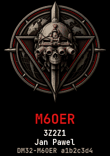
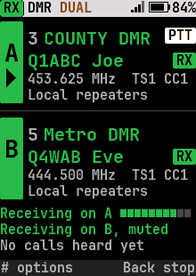
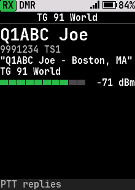
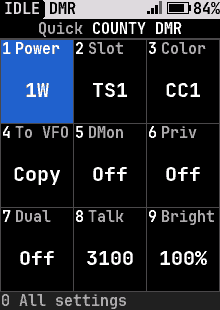
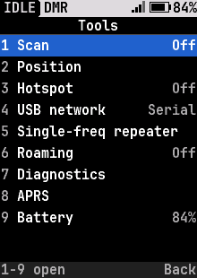

# DM32-M6OER: custom firmware for the Baofeng DM-32UV

<p align="center">





</p>

> **⚠️ Baofeng DM-32UV only.** This firmware is built and tested for the DM-32UV alone. There is no DM32-M6OER image
> for any other radio, and none is planned for now. Do not flash it to another model: it will not work and can leave
> that radio unusable.

Kriss M6OER's own firmware for the DM-32UV: **FM, DMR, C4FM (Yaesu System Fusion), P25 and NXDN in one firmware**.
It is built on [RadioFoundry C4FM](https://github.com/lycanananas/RadioFoundryC4FM), which is built on
[RadioFoundry](https://radiofoundry.org). Not affiliated with either project.

**Download:** [the latest release](https://github.com/vipersq/DM32-M6OER/releases/latest) or [firmware/](firmware/).
**Experimental:** use at your own risk and keep your codeplug backed up.

## Features

| Area | What you get |
|---|---|
| Modes | FM, DMR, C4FM (DN voice, DG-ID, Wires-X), P25 and NXDN |
| DMR | both timeslots, any talkgroup and any colour code monitoring, an extra RX talkgroup, the caller's name and city from the RadioID database |
| Audio | 17 roger beeps (including a CB two-tone) with volume and tail; a mic compressor and a stronger mic level |
| Tactical | key-up, unkey, RX and RX end tones (single, double or triple, adjustable volume), a red tactical screen, side key functions |
| Screen | your own boot picture with your callsign; Quick pages per mode; dual watch with both channels on screen |
| Data | APRS with messaging and SmartBeaconing; a KISS TNC on the programming cable; Tools > Data link for [RadioLink](https://github.com/vipersq/RadioLink) (ATAK over radio): in FM on a frequency of its own, or as DMR data on a DMR channel's talkgroup; DMR voice through the phone (its microphone and speaker over the same cable, [aprs.md 9.5](docs/spec/aprs.md#95-dmr-voice-over-the-host-port)) |

What changed in this build, in detail: [docs/spec/c4fm.md](docs/spec/c4fm.md).

## Installing

1. Download `DM32-M6OER-vX.Y.Z.bin` from the [latest release](https://github.com/vipersq/DM32-M6OER/releases/latest).
2. Flash it with the installer at [radiofoundry.org](https://radiofoundry.org): Select Features, "Use my own firmware
   build", "Firmware file (.bin)".
3. Cable: the radio's USB programming cable (K1 plug, CH340 or FTDI chip). The USB-C cable in the box only charges
   the battery.

## The AMBE codec

DMR and C4FM voice need DVSI's proprietary AMBE+2 vocoder. It is **not included**, in this repository or in any
image: the installer takes it from your own radio's stock firmware. Without it the firmware runs FM only. Details:
[the codec](docs/dev/codec.md).

## Building

You need make, Python 3.11 or later and a `csky-elf` GCC (`tools/build-csky-toolchain.sh`).

```
make BOARD=dm32 VARIANT=c4fm      # build/dm32-c4fm/rfoundry_dm32.bin
make -C tests/host                # host tests
```

## Layout

| Path | What |
|---|---|
| `core/` | radio logic, protocols (DMR, C4FM in `core/c4fm/`, P25, NXDN, APRS) and the user interface |
| `boards/dm32/` | the DM-32UV's wiring, display and calibration |
| `platform/hrc7000/`, `drivers/` | the radio's processor and chips |
| `tests/host/` | host tests and the screen gallery |
| `firmware/` | the released images |
| `docs/` | RadioFoundry's documentation (all radios) |

## Licence

The firmware image is **GPL-2.0-or-later** (it contains `core/c4fm/`, GPL-2.0-or-later). RadioFoundry's files are
MIT ([LICENSE](LICENSE), [AUTHORS](AUTHORS)). The source of each image is this repository at its tag. This build's
changes: Copyright (c) 2026 Kriss M6OER, under the license of each file they are in. Every license in the image and
what you may do when sharing it: [LICENSING.md](LICENSING.md).

## Credits

- [RadioFoundry](https://radiofoundry.org) and its authors ([AUTHORS](AUTHORS)): the firmware this is built on.
- [RadioFoundry C4FM](https://github.com/lycanananas/RadioFoundryC4FM): Yaesu System Fusion on the DM-32UV.

The documentation under [docs/](docs/README.md) is RadioFoundry's and describes the whole project, including radios
this build does not support.

73 de M6OER
